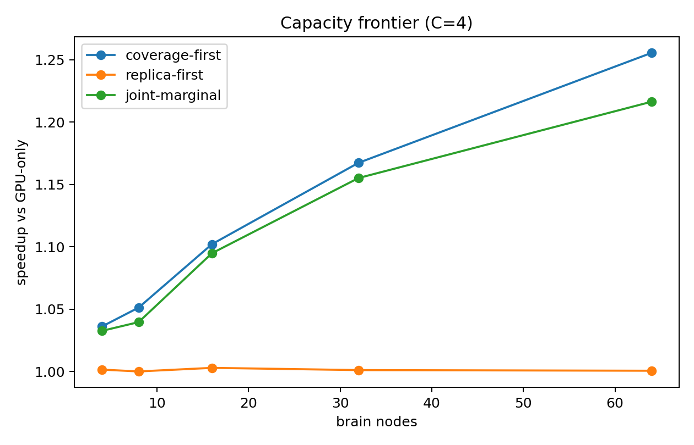
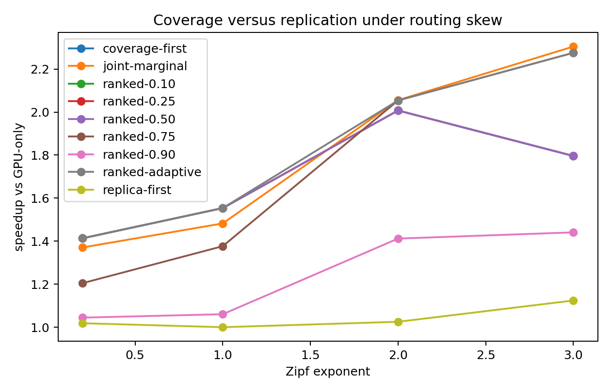
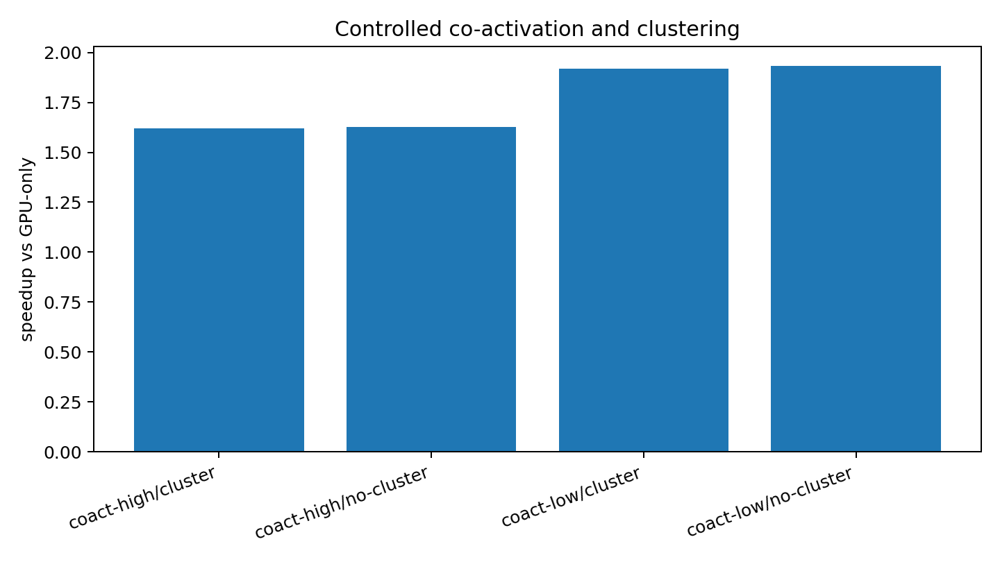
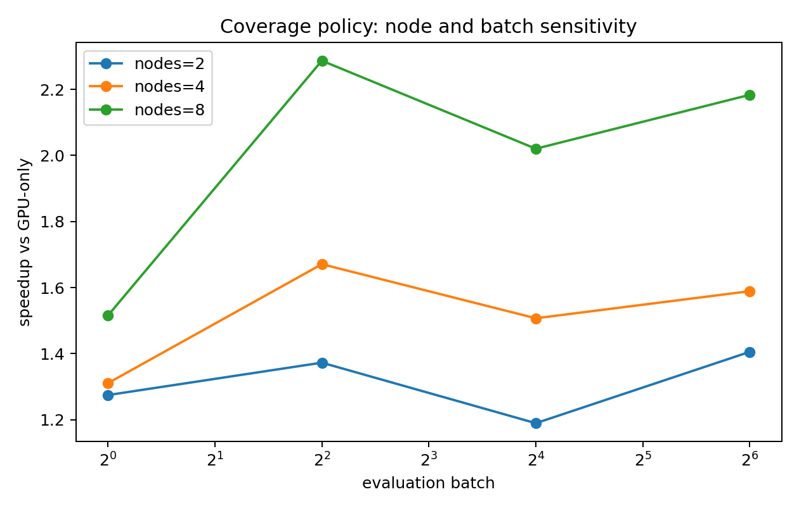
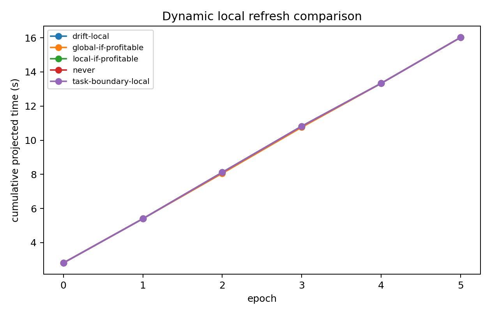

# MoE 专家分层与刷新实验结果 v1

> **证据状态警告：** 当前源码已晚于本文引用的 `final_v4` 结果清单，ranked/预算逻辑
> 在结果生成后发生过修改。本文数值只能用于形成假设和筛选实验点，不能作为最终
> canonical 证据。最后一个相对完整的参考包是 `moe_2026_final_v3`，但仍需在冻结
> 后的源码上重跑。正式设计见
> [`MOE_高置信度实验设计_v2_冻结版.md`](MOE_高置信度实验设计_v2_冻结版.md)。

> 日期：2026-10-20  
> 结果包：`experiments/moe_2026_final_v4/`  
> 代码状态：`112 passed`  
> 证据边界：paper-constrained synthetic routing + projected hardware；不是真实 router trace，也不是 KA200 真机测量。

## 1. 执行结论

本轮已经完成软件模型内的 E0–E6：

- E0：现有测试与新增研究测试通过；
- E1/E2：全 DeepSeek 专家形状下的容量、覆盖和复制比较；
- E3：受控共激活、聚类开关与 `C` 扫描；
- E4：node × batch 交互；
- E5：稳定、渐变和突变任务下的刷新比较；
- E6：跨 seed、bridge 带宽和 brain kernel latency 敏感性。

当前最重要的结果为：

1. **覆盖优先在一般偏斜下优于过早复制。** 全模型静态矩阵中，
   `coverage-first` 在 21/25 个匹配点胜出，4 个点打平，
   `joint-marginal` 没有在一般偏斜点胜出。
2. **渐进 ranked 策略可以跨越 skew 边界。**
   低偏斜时自动选择接近 coverage 的行为，高偏斜时自动增加热复制。
3. **极强热点下复制才占优。** Zipf exponent 为 2.0 时
   `joint-marginal` 略优于 coverage；为 3.0 时明显胜出。
4. **增加类脑容量持续提高总吞吐，但单位 node 效率下降。**
5. **当前聚类目标没有转化为明显 completion 收益。**
   coactivation 加强了共激活，但 cluster on/off 的延迟基本不变。
6. **刷新在短 epoch 中不划算。** 只有一个全局刷新被采纳，
   累计收益约 0.037%，没有实际意义；局部刷新均未达到净收益门槛。
7. **结论对 brain kernel latency 很敏感。** brain kernel 变慢 2 倍后，
   大部分收益降到约 1.04–1.24×。

这些是模型内的机制结论，不能直接写成 KA200 真机结论。

## 2. 参考配置

| 项目 | 本轮取值 |
|---|---|
| 主模型形状 | DeepSeek-V3：58 个 MoE 层 × 256 个 routed experts |
| expert 大小 | `3 × 7168 × 2048` bytes = 42 MiB |
| GPU fallback | 16 个 H100 等容量计算域，每 GPU 80 GB，预留 20% |
| Brain 主配置 | 8 chips/node，projected 768 MB/chip |
| 容量扫描 | `C=1,2,4,8,14` experts/chip |
| Node 扫描 | 4, 8, 16, 32, 64 |
| 机制实验 | 8 层 × 64 experts，固定总副本数 |
| 网络 | scale-up 90 GB/s、scale-out 39 GB/s、bridge 51.2 GB/s |
| 路由 | task-conditioned community synthetic |
| GPU 选择 | earliest-finish |

所有 GPU/HBM 和模型几何来自本地公开配置；brain kernel 是 hardware-relative
synthetic curve，不是 KA200 测量。

## 3. 覆盖与复制

全模型下 `C=4` 的 speedup 随 brain node 数变化：

| Nodes | Coverage | Joint | Replica |
|---:|---:|---:|---:|
| 4 | 1.036× | 1.033× | 1.001× |
| 8 | 1.051× | 1.040× | 1.000× |
| 16 | 1.102× | 1.095× | 1.003× |
| 32 | 1.167× | 1.155× | 1.001× |
| 64 | 1.256× | 1.216× | 1.001× |

全模型 `C=14`：

| Nodes | Coverage | Joint | Replica | Coverage tokens/s/node |
|---:|---:|---:|---:|---:|
| 4 | 1.097× | 1.086× | 1.009× | 2,267.9 |
| 8 | 1.150× | 1.124× | 1.003× | 1,167.0 |
| 16 | 1.201× | 1.175× | 1.006× | 623.9 |
| 32 | 1.359× | 1.290× | 1.002× | 354.0 |
| 64 | **1.798×** | 1.324× | 1.001× | 231.1 |

总吞吐随 node 增加，但 `tokens/s/node` 从 2,267.9 降到 231.1，说明收益
主要来自更多硬件，而不是单位 node 效率提升。不能将 1.798× 描述为
“更少节点得到更高吞吐”。



### Skew 边界

固定 8 层 × 64 experts、相同副本数：

| Zipf exponent | Coverage | Replica | Joint | Ranked-adaptive | 最优 |
|---:|---:|---:|---:|---:|---|
| 0.2 | **1.413×** | 1.019× | 1.371× | **1.413×** | coverage/ranked |
| 1.0 | **1.554×** | 1.000× | 1.482× | **1.554×** | coverage/ranked |
| 2.0 | 2.007× | 1.025× | **2.055×** | 2.054× | joint/ranked |
| 3.0 | 1.796× | 1.124× | 2.305× | 2.276× | joint/ranked |

这证明“先覆盖还是先复制”必须由路由偏斜和副本边际收益决定，不能固定顺序。
`ranked-adaptive` 在每个测试点都选择了接近最优的复制强度：

- 低偏斜使用 0.10 的复制预留；
- 中等集中度使用 0.25；
- top-10% 专家覆盖流量超过 70% 时使用 0.75。

它只使用 placement window 的集中度，不使用未来 evaluation trace。



### Full-model selected ranked points

C=14、64 nodes 时：

| Policy | Unique covered | Replicas | Speedup |
|---|---:|---:|---:|
| Coverage | 7,168 | 7,168 | **1.798×** |
| Joint | 2,728 | 7,168 | 1.324× |
| Ranked-0.25 | 5,376 | 7,168 | 1.553× |
| Ranked-0.50 | 3,584 | 7,168 | 1.386× |
| Ranked-0.75 | 1,792 | 7,168 | 1.225× |
| Ranked-adaptive | 5,376 | 7,168 | 1.553× |

该 workload 未达到 adaptive 的 0.70 集中度阈值，因此选择 0.25。
它显著优于纯复制和 joint，但在中等偏斜下仍低于 full coverage。

## 4. 共激活与 C

固定总副本数 256、相同拓扑容量，比较 coactivation 强度和 cluster objective：

| Coactivation | Cluster weight | Mean speedup |
|---|---:|---:|
| low | 0 | 1.933× |
| low | 2 | 1.917× |
| high | 0 | 1.628× |
| high | 2 | 1.620× |

当前聚类目标改变了 local assignment fraction，但没有降低 completion。
因此本轮**不支持**“pair-affinity 聚类能自动带来系统收益”的主张。

`C=2/4/8` 在同一副本总数下也没有形成明显的 completion 差异。可能原因：

- 当前 synthetic kernel 让计算/队列成为主瓶颈；
- 共激活只影响 node locality，而 flow latency 未进入关键路径；
- pair expansion 不等价于完整 hyperedge partition；
- 尚未用真实 trace 验证每层共激活结构。

这不能证明真实硬件上聚类无效，只能说明当前模型和 workload 下没有支持证据。



## 5. Node × batch

Coverage policy 的 speedup：

| Nodes | B=1 | B=4 | B=16 | B=64 |
|---:|---:|---:|---:|---:|
| 2 | 1.275× | 1.373× | 1.189× | 1.405× |
| 4 | 1.311× | 1.671× | 1.507× | 1.589× |
| 8 | **1.515×** | **2.287×** | **2.020×** | **2.183×** |

收益不是随 batch 单调变化；`B=16` 出现下降后 `B=64` 又上升。这说明
grouped-GEMM `M`、chip queue、node fanout 和网络争用共同决定结果，
不能用简单的“batch 越大越好”或“node 越多越好”替代 detailed simulation。



## 6. 刷新

六个稳定 epoch，每个 epoch 投影为 4096 decode steps。
任务混合从 code-heavy 逐渐切到 math-heavy。

| Policy | Adoptions | Final cumulative time |
|---|---:|---:|
| Never | 0 | 16.022016 s |
| Global-if-profitable | 1 | 16.016108 s |
| Local-if-profitable | 0 | 16.022016 s |
| Drift-local | 0 | 16.022016 s |
| Task-boundary-local | 0 | 16.022016 s |

唯一一次全局刷新迁移了 252 个副本、约 11.10 GB，按并行 bridge 估算
迁移耗时约 27.5 ms；累计收益仅约 0.037%。

本轮结论：

- 在这个任务持续时间和迁移成本下，刷新策略不值得；
- 单副本局部改动没有产生足以覆盖迁移成本的收益；
- 不能据此宣称真实系统永不刷新；
- 更长 epoch、更便宜迁移或更剧烈且持续的 drift 可能改变结论。



## 7. Seed 与敏感性

固定 8 层 × 64 experts、8 nodes、C=4、3 个 placement/evaluation seed pair：

| Policy | Mean speedup | 95% CI | 结论 |
|---|---:|---:|---|
| coverage-first | 2.078× | 1.812–2.344× | supported |
| joint-marginal | 1.643× | 1.371–1.915× | supported |

该 CI 只覆盖 synthetic seed 变化，不覆盖真实 trace 采样或硬件测量误差。

bridge 0.25×–4×、brain kernel 0.5×–2× 的敏感性：

- coverage 和 joint 在大多数点仍高于 1；
- brain kernel 变慢 2× 时，收益显著收窄到约 1.04–1.24×；
- bridge 从 1× 提高到 4× 没有继续改善，说明当前不是 bridge 串行瓶颈；
- bridge 降到 0.25× 时，部分配置收益下降。

最重要的敏感参数是 brain expert kernel latency。

## 8. 可信度与限制

### 已具备

- 同一 GPU、同一 topology、同一 SRAM budget 的 paired comparison；
- placement/evaluation split；
- detailed max-min network、chip queue、grouped kernel；
- seed CI；
- task-conditioned synthetic routing；
- capacity、skew、coactivation、C、node、batch、refresh 和参数敏感性；
- 输入与源码 SHA-256。

### 仍缺失

- 真实 request-ordered router trace；
- 真实 trace 的 request/block bootstrap；
- KA200 `t_expert(M)`、NoC、bridge、multicast/reduce 和功耗实测；
- detailed 1024-chip 以上拓扑的可扩展运行；
- 真正共享链路的后台 migration 流；
- 与真实 serving engine 的端到端校准。

因此本轮证据等级是：

```text
software-model mechanism evidence
```

不是：

```text
KA200 measured performance
```

## 9. 结果文件

- `static_capacity.csv`
- `skew.csv`
- `community.csv`
- `node_batch.csv`
- `refresh.csv`
- `seeds.csv`
- `seed_ci.csv`
- `sensitivity.csv`
- `ranked_full.csv`
- `summary.json`
- `details.json`
- `manifest.json`
- 对应 PNG 图

全部位于：

[experiments/moe_2026_final_v4](../experiments/moe_2026_final_v4/)

## 10. 下一阶段不应重复的工作

不要重新跑已经完成的通用容量和 skew 扫描。下一步只有在以下证据变化后才应
重跑：

- 获得真实 trace；
- 获得 KA200 measured profile；
- 改变 HBM fallback 或类脑 DRAM 语义；
- 改变 migration 服务模型；
- 改变 expert TP/分片；
- 发现更大的可用计算资源并修复超大拓扑扩展问题。
